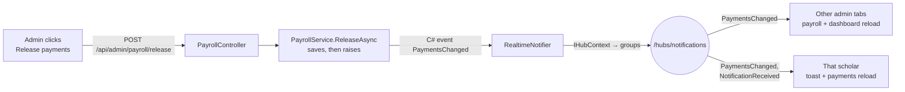

# IskolarAid

Manage scholars, scholarships, payroll and compliance for Legacy College of Compostela.

The app began as a WinForms + MySQL desktop program (the `/SkolarAid` folder, kept as it was, old spelling included). The web version lives on the `migrate/angular-aspnet` branch.

| Part | Stack |
| --- | --- |
| [web/](web) | Angular 22, Tailwind CSS 4 |
| [api/](api) | ASP.NET Core 10, EF Core 9 with Pomelo, JWT |
| Database | MySQL 8 or MariaDB, same schema as the desktop app |

More background: [MIGRATION_PLAN.md](MIGRATION_PLAN.md) explains the decisions, and [PARITY_CHECKLIST.md](PARITY_CHECKLIST.md) maps each old feature to its new place.

## Try it

```bash
./run.sh demo
```

Starts the API and the web app on a throw-away SQLite database at <https://localhost:4200>. Sign in as `admin` / `Admin#12345`. Needs no MySQL and no Docker, but it is for looking around only.

The other commands:

```bash
./run.sh dev      # API + web on the real database from .env; starts a local MariaDB in .run/ if none is up
./run.sh dev --lan  # the same, and other devices on your network can open it too
./run.sh cert     # create or refresh the HTTPS certificate (demo and dev do this by themselves)
./run.sh share-ca # let another device trust this machine's certificates
./run.sh db       # start a MariaDB in .run/ without sudo, using the names in .env
./run.sh mailpit  # install Mailpit once; demo/dev then show every email at http://localhost:8025
./run.sh docker   # build and start API, MySQL and web with Docker
./run.sh test     # run the API and web tests
./run.sh stop     # stop whatever the script started, the local MariaDB included
```

## Email while developing

With `SMTP_HOST` empty, nothing would be emailed, so a new scholar would not get the email with their Scholar ID and sign-up link. Run `./run.sh mailpit` once. After that, `./run.sh demo` and `./run.sh dev` start [Mailpit](https://github.com/axllent/mailpit) next to the app and send every email to it: open http://localhost:8025 to read them. Nothing reaches real inboxes. It listens on `localhost` only, even with `--lan`, because the inbox shows scholars' personal details. Set `SMTP_HOST` to use a real mail server, or `MAIL_CATCHER=0` to switch Mailpit off.

## How scholars get an account

The site is for people who are already scholars; it does not take scholarship applications.

1. An admin adds the scholar in **Scholar Management**. The scholarship type box suggests common Philippine scholarships (CHED, UniFAST TES/TDP, DOST-SEI, OWWA and more); typing a new name creates a new type.
2. The scholar gets an email with their **Scholar ID** (e.g. `SCH-2026-001`). The account stays locked until step 3.
3. On **Sign up** (`/signup`) the scholar enters the Scholar ID plus their Student ID or email and chooses a password (8+ characters, a letter and a number). They are signed in straight away and log in with their Student ID from then on.

Older scholars from the desktop app can sign up the same way. Each scholar can sign up only once.

## How payroll works

Admin > **Payroll Processing**. These rules answer the questions people ask about it:

* **Frequency and period.** A scholarship pays its stipend amount **once per cycle**: Monthly (1 month), Quarterly (3), Semi-Annual (6) or Annual (12). The payroll period is the cycle being paid now, so it must last one cycle of the scholar's frequency (`PayrollRules.PeriodFitsFrequency`). A Semi-Annual scholar cannot be paid for a single month, and the amount is never multiplied or split. The stipend amount and the frequency both come from the scholarship type, and the scholar form shows them read-only for an existing type.
* **Not in advance.** A period that has not started yet cannot be paid, so a release never comes before its period.
* **Process, then release.** *Process* creates payments with status `Processed` and an **expected release date**: 3 working days away unless the admin picks another day (`PayrollRules.CalculateReleaseDate`). *Release* is the admin confirming the money was handed out. Nothing is released automatically, and the release date then becomes the real day.
* **When the money is late.** The admin moves the expected date with **Change** (`POST /api/admin/payroll/payments/{id}/reschedule`). The scholar is notified and the change is logged. Only `Processed` payments can be moved.
* **No double payment.** A payment can be released only once, and a scholar cannot be paid again for any day a payment already covers, even with a different period.
* **Payment method.** Bank Transfer needs a bank name and an account number on the scholar's profile. Cash and Mobile Wallet need nothing extra.

## HTTPS

`./run.sh demo` and `./run.sh dev` serve the app over HTTPS, with no browser warning. The certificate comes from [mkcert](https://github.com/FiloSottile/mkcert): a small certificate authority (CA) that belongs to your machine and that your system and browsers trust. Only the web dev server speaks HTTPS. It forwards `/api` and `/hubs` to the API on `localhost`, so live updates run over `wss://`.

The certificate lives in `.run/certs` (not committed). It covers `localhost`, the machine's name (`<name>` and `<name>.local`) and its network addresses. The script makes a new one by itself when the network address changes or the old one is about to expire.

### A new computer for running the app

1. Install mkcert and the NSS tools Firefox and Chrome use:
   * Arch: `sudo pacman -S mkcert nss`
   * Debian/Ubuntu: `sudo apt install mkcert libnss3-tools`
   * macOS: `brew install mkcert nss`
   * Windows: `choco install mkcert`
2. Run `./run.sh dev` (or `demo`). On the first run it creates the machine's CA and trusts it, which may ask for your password once. Then it makes the certificate.
3. Restart the browser if it was already open.

Each computer has its own CA. Never copy `rootCA-key.pem` (in `mkcert -CAROOT`) to another machine or into the repo. Anyone with that file can create certificates your devices will trust.

Without mkcert, the script falls back to a self-signed certificate. Browsers will warn about it, but the app still works. `NO_HTTPS=1 ./run.sh dev` serves plain HTTP.

### A new phone, tablet or laptop that only opens the app

The other device has to trust the CA of the computer running the app, once. Start the app with:

```bash
./run.sh dev --lan
```

Next to the app's addresses it prints a **New device?** block with a link to the CA certificate, a QR code and the CA's fingerprint. The certificate is shared on port 8000 for as long as the app runs. `./run.sh share-ca` shows the same link, plus the install steps for each system, without starting the app.

On the device:

1. Open the link or scan the QR code.
2. Install the file as a trusted certificate authority:
   * **Android:** Settings → Security → More security settings → Encryption & credentials → Install a certificate → CA certificate.
   * **iPhone/iPad:** Allow the download in Safari, then Settings → Profile Downloaded → Install, then Settings → General → About → Certificate Trust Settings and turn it on.
   * **Windows:** Double-click → Install Certificate → Local Machine → Trusted Root Certification Authorities.
   * **macOS:** Double-click to add it to the System keychain, open it, and set Trust to Always Trust.
3. Check that the fingerprint the device shows matches the one in the terminal.
4. Open `https://<computer's IP>:4200`, which the script prints too.

**The link changes when the computer's IP address changes**, for example on a new Wi-Fi network or a new DHCP lease, so take it from the terminal each time. The certificate behind it stays the same: the CA lasts about 10 years, so a device you have set up keeps working. Only the address you type changes.

Both devices must be on the same network, and the computer's firewall must allow ports 4200 and 8000. `--lan` makes the dev server reachable by everyone on that network, so use it only on networks you trust. Only the public certificate is ever shared, never the CA's private key. To remove trust later, delete the certificate in the device's settings, on the same screen where you installed it.

## Run with Docker

```bash
cp .env.example .env
docker compose up --build
```

Fill in `MYSQL_ROOT_PASSWORD`, `MYSQL_PASSWORD`, `JWT_KEY` and `SEED_ADMIN_PASSWORD` in `.env` first. Then open <http://localhost:4200> and sign in with `SEED_ADMIN_USERNAME` and `SEED_ADMIN_PASSWORD`.

On start the API applies the EF migrations and creates the first admin if there is none. Set `SEED_SAMPLE_DATA=true` to add three sample scholarship types.

## Run without Docker

You need the .NET 10 SDK, Node 22+ and a MySQL 8 server.

```bash
mysql -u root -p -e "CREATE DATABASE iskolaraid CHARACTER SET utf8mb4;"

cd api
export ConnectionStrings__Default="Server=localhost;Port=3306;Database=iskolaraid;User=root;Password=YOUR_PASSWORD;"
export Jwt__Key="$(openssl rand -base64 48)"
export Database__AutoMigrate=true
export Seed__AdminUsername=admin Seed__AdminPassword='pick-a-strong-one' Seed__SampleData=true
dotnet run --project src/IskolarAid.Api      # http://localhost:5080

cd ../web
npm install
npm start                                    # http://localhost:4200, proxies /api to :5080
```

In `Development` the API makes up a JWT key when `Jwt__Key` is empty, so tokens stop working after a restart. Any other environment refuses to start without one.

## Fill a dev database with fake data

Set these in `.env` before `./run.sh dev`:

| Variable | Effect |
| --- | --- |
| `SEED_DEMO_LOGINS=true` | Creates `Adachi` (admin, `adachi123`) and `Shimamura` (scholar, `shimamura123`) on every start. On by default in dev, so turn it off anywhere real. |
| `SEED_HISTORICAL_DATA=true` | Adds two years of scholars, compliance, payroll, notifications and logs once. Seeded scholars sign in with their student ID and `Scholar#123`. |

## Keep an existing desktop database

Back it up, then run [db/existing-database.sql](db/existing-database.sql) once. It widens `users.password`, adds the nullable `scholar_registrations.student_id` column and records the EF baseline so the API leaves the existing tables alone. Old plaintext passwords keep working and get hashed the first time each user signs in.

## Configure

ASP.NET reads `Section__Key` as `Section:Key`. Docker reads the names in [.env.example](.env.example).

| Variable | Needed | What it does |
| --- | --- | --- |
| `ConnectionStrings__Default` | yes | Connects to the database |
| `Jwt__Key` | outside Development | Signs tokens (32+ characters) |
| `Jwt__ExpiryMinutes` | no, 480 | Sets how long a token lasts |
| `Cors__Origins` | no, `http://localhost:4200` | Lists the browser origins allowed, comma separated |
| `Database__AutoMigrate` | no, false | Applies EF migrations on start |
| `Database__ServerType` / `Database__ServerVersion` | no, MySql / 8.0.36 | Tells Pomelo which server to expect (use `MariaDb` for MariaDB) |
| `Seed__AdminUsername` / `Seed__AdminPassword` | first run | Creates the first admin if none exists |
| `Seed__SampleData` | no | Adds sample scholarship types to an empty table |
| `Smtp__Host`, `Port`, `User`, `Password`, `FromAddress`, `LoginUrl` | no | Sends email (welcome, approval, rejection, payroll). No host, no email |
| `Uploads__MaxBytes` | no, 10 MB | Largest compliance document a scholar or admin can upload |

> The desktop app's public source contains a Gmail app password and a Semaphore API key. This version does not use them, but they are still exposed upstream, so revoke them.

## Build and test

```bash
cd api
dotnet build
dotnet test       # 81 tests: rules, services, events, the hub, and HTTP end to end on SQLite
dotnet dotnet-ef migrations add <Name> --project src/IskolarAid.Data --startup-project src/IskolarAid.Data
dotnet dotnet-ef database update --project src/IskolarAid.Data --startup-project src/IskolarAid.Data

cd ../web
npm test -- --watch=false    # 21 Vitest tests
npm run build                # bundle goes to web/dist
```

## Find your way around

```text
api/src/IskolarAid.Api    controllers, JWT, startup and seeding
api/src/IskolarAid.Api/Realtime   SignalR hub and the notifier that forwards C# events to browsers
api/src/IskolarAid.Core   services, DTOs and the business rules ported from WinForms
api/src/IskolarAid.Data   entities, DbContext, migrations
api/tests                 xUnit unit tests and end-to-end tests
web/src/app/core          API client, auth, dialogs, formatting, the live-updates connection (realtime.ts)
web/src/app/layout        the admin and scholar shells
web/src/app/pages         one component per original WinForms screen
web/src/app/shared        icons, modals, summary strip, form errors, chart setup
```

## Change something

Run `./run.sh test` before you push. It runs the API and web test suites in one go.

## Live updates

Screens update by themselves when something changes elsewhere: a scholar sees a new notification or payment without pressing Refresh, and an admin sees uploaded documents and payroll changes as they arrive. The header shows **Live**, **Reconnecting…** or **Offline**. When it is offline, every page still works over plain HTTP.

How one change travels, from a click to every screen that cares:



1. **UI event:** a button or form calls a service.
2. **Request:** `HttpClient` sends it to the API.
3. **Server:** the controller calls a service, which saves and then raises a C# event on `AppEvents`.
4. **Broadcast:** `RealtimeNotifier` listens to those events and sends a SignalR event to the right groups.
5. **UI update:** `RealtimeService` turns server events into RxJS streams. Pages reload their data over HTTP, because HTTP stays the source of truth.

### Events

| C# event (raised by) | SignalR event | Who hears it | What reacts |
| --- | --- | --- | --- |
| `NotificationsSent` (compose, compliance reminder, payroll) | `NotificationReceived { title, type }` | each recipient scholar | toast with **View**, notifications, dashboard |
| | `NotificationsChanged { count }` | admins | Notifications page |
| `PaymentsChanged` (process, release) | `PaymentsChanged { status, count }` | admins and the scholars paid | payroll, payment history, dashboards |
| `ComplianceChanged` (upload, status change, add/delete requirement) | `ComplianceChanged { scholarId, requirement, status, byScholar }` | admins and that scholar | compliance screens, payroll eligibility, toast when a scholar uploads |

Payloads carry ids and what changed, never whole records.

### Rules the code follows

* **One connection per signed-in user.** The shells open it and close it on logout. Handlers are registered once, in `RealtimeService`, and pages subscribe with `takeUntilDestroyed()`, so revisiting a page never stacks listeners.
* **Groups come from the token, not the client.** On connect the hub puts admins in `admins` and a scholar in `scholar-{id}`, so a scholar can only hear their own events. A reconnect is a new connection, which runs the same step again, so nothing needs re-joining.
* **Missed events are reloaded.** SignalR does not store messages for offline clients. After any reconnect, `reconnected$` fires and every open page reloads over HTTP.
* **The hub needs a JWT.** WebSockets cannot carry an `Authorization` header, so the client sends the token as `?access_token=`, which the API accepts on `/hubs/*` only. CORS lists exact origins with `AllowCredentials()`, as the SignalR browser client requires.
* **A failing listener never fails the request.** Events are raised after the save, and errors in a subscriber or in a push are only logged.

To watch it work, open the admin portal and a scholar portal in two browser windows, then compose a notification or release a payment. DevTools → Network → **WS** shows each frame. In development, the console also logs every API call as `[HTTP] GET /api/... -> 200 (12 ms)`.

## Know who can do what

* `ADMIN` reaches every `/api/admin/*` endpoint and `/admin/*` route.
* `SCHOLAR` reaches `/api/scholar/*` only. The API reads the scholar from the JWT and never trusts an id from the client.
* Passwords go through ASP.NET's `PasswordHasher` (PBKDF2). Login errors never say whether a username exists, and login and sign-up are rate limited. Sign-up gives the same answer for a wrong Scholar ID and a wrong Student ID or email.
* Compliance uploads accept PDF, Word, JPG and PNG up to 10 MB (stored in the database). Profile pictures accept JPG, PNG and WebP up to 5 MB.
* CSV exports defuse spreadsheet formula injection.

## Known gaps

[PARITY_CHECKLIST.md](PARITY_CHECKLIST.md) lists what was and was not tested.

* Live updates run on a single API instance. Running several would need a SignalR backplane (Redis or Azure SignalR Service).
* An open live connection is not cut when the sign-in token expires (8 hours by default). The next reconnect fails and the header shows **Offline**, and the next API call signs the user out as usual.
